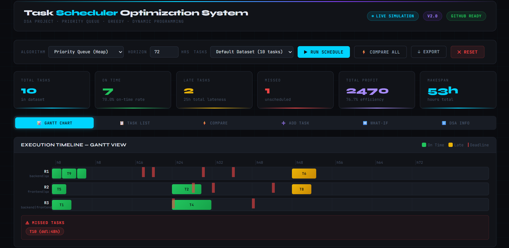
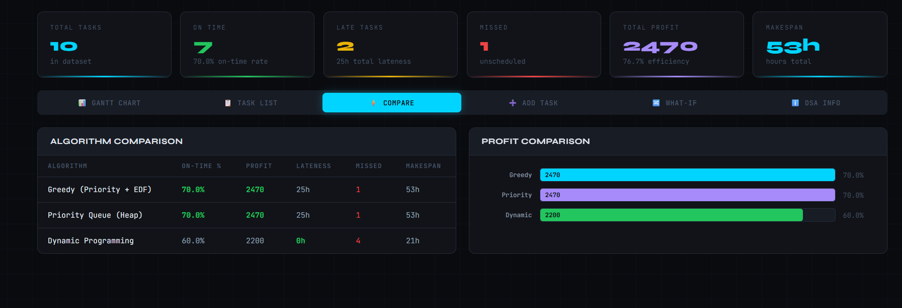
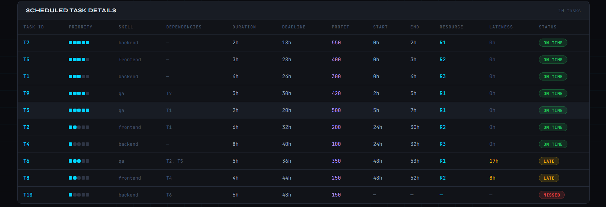
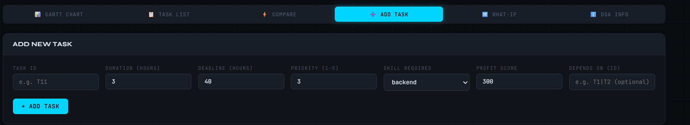
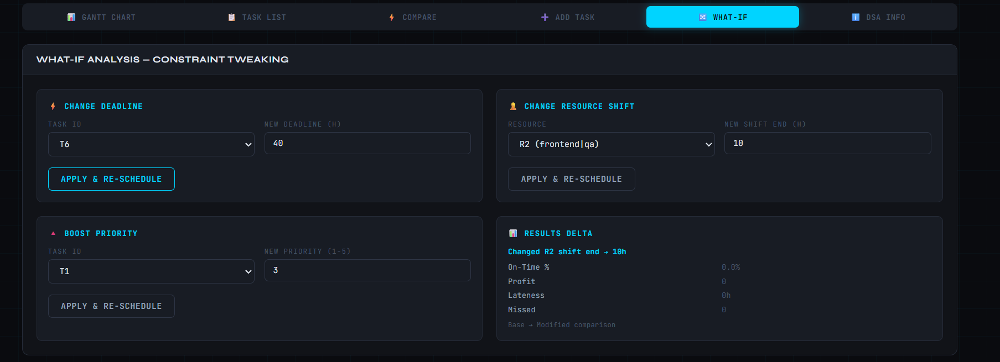

# Task Scheduler Optimization System

> A constraint-aware scheduling system that assigns tasks to time slots and resources to minimize lateness while maximizing profit — built with 3 algorithms, an interactive dashboard, and interview-ready code.


---

## Project Overview

The **Task Scheduler Optimization System** solves the real-world problem of scheduling multiple tasks across multiple resources (workers/machines) while satisfying:

- **Deadline constraints** — complete tasks before they're due
- **Dependency constraints** — some tasks require others to finish first
- **Skill constraints** — each task requires a specific skill (backend, frontend, qa)
- **Shift-window constraints** — workers are only available during their shift hours

It implements **3 scheduling algorithms** with a side-by-side comparison and a professional interactive dashboard.

---

## Problem Statement

Given **N tasks** each with:

- Duration, deadline, priority (1-5), skill requirement, dependencies, and profit score

And **M resources** each with:

- Skills, shift start/end hours, max hours per day

**Goal:** Schedule tasks to maximize on-time completions and total profit.

---

## DSA Concepts Used

| Concept                       | Where Used                               | Complexity        |
| ----------------------------- | ---------------------------------------- | ----------------- |
| **Priority Queue (Min-Heap)** | `heapq` in PQ Scheduler                  | O(log N) push/pop |
| **Greedy Algorithm**          | GreedyScheduler                          | O(N log N)        |
| **Dynamic Programming**       | DPScheduler (Weighted Job Scheduling)    | O(N²)             |
| **Topological Sort**          | Kahn's Algorithm for dependency ordering | O(V+E)            |
| **Binary Search**             | DP predecessor search                    | O(log N)          |
| **Hash Map**                  | Task/resource lookup                     | O(1)              |
| **Adjacency List**            | Dependency graph                         | O(V+E)            |
| **Deque**                     | BFS queue for Kahn's algorithm           | O(1) push/pop     |

---

## Architecture

```
INPUT (CSV)                   PROCESSING                     OUTPUT
─────────────────        ──────────────────────────       ──────────────
tasks.csv     ──►  Load  ──►  Validate           ──►    Optimized Schedule
resources.csv ──►  Parse ──►  Topological Sort   ──►    Gantt Chart
                         ──►  Algorithm Engine   ──►    KPI Report
                              │                         CSV / TXT files
                              ├── Greedy (EDF)
                              ├── Priority Queue
                              └── Dynamic Programming
```

---

## Folder Structure

```
Task-Scheduler-Optimization-System/
│
├── data/
│   ├── tasks.csv            # Task dataset (ID, duration, deadline, priority, skill, deps, profit)
│   └── resources.csv        # Resource dataset (ID, skills, shift hours)
│
├── src/
│   ├── __init__.py
│   ├── models.py            # Task and Resource dataclasses + CSV loaders
│   ├── greedy_scheduler.py  # Greedy: EDF + Priority + Topological Sort
│   ├── priority_scheduler.py# Priority Queue (min-heap) scheduler
│   ├── dp_scheduler.py      # DP: Weighted Job Scheduling Problem
│   ├── metrics.py           # KPI calculation and algorithm comparison
│   └── report_generator.py  # CSV and text report generation
│
├── tests/
│   └── test_schedulers.py   # Unit tests for all schedulers
│
├── outputs/                 # Generated reports and CSVs (auto-created)
├── images/                  # Screenshots for GitHub
├── docs/                    # Additional documentation
│
├── dashboard.html           #  Interactive professional dashboard (open in browser)
├── main.py                  # CLI entry point
├── requirements.txt         # Dependencies
├── .gitignore
└── README.md
```

---

## 📊 Screenshots

### Gantt Chart Visualization



### KPI Summary Dashboard



### Schedule Details



### Task Input Management



### What-If Analysis



## Installation & Setup

### Prerequisites

- Python 3.9 or higher
- No pip installs needed (uses only standard library)

### Windows

```bash
git clone https://github.com/YOUR_USERNAME/Task-Scheduler-Optimization-System
cd Task-Scheduler-Optimization-System
python main.py
```

### Mac/Linux

```bash
git clone https://github.com/YOUR_USERNAME/Task-Scheduler-Optimization-System
cd Task-Scheduler-Optimization-System
python3 main.py
```

---

## How to Run

### 1. Run All 3 Algorithms (default)

```bash
python main.py
```

### 2. Run Specific Algorithm

```bash
python main.py --algo greedy
python main.py --algo pq        # Priority Queue
python main.py --algo dp        # Dynamic Programming
```

### 3. Compare All Algorithms Side-by-Side

```bash
python main.py --compare
```

### 4. Custom Horizon

```bash
python main.py --horizon 96     # 96-hour planning window
```

### 5. Add Task Interactively

```bash
python main.py --add-task
```

### 6. Run Tests

```bash
python tests/test_schedulers.py
```

### 7. Open Dashboard

Just open `dashboard.html` in any browser — no server needed!

---

## Sample Output

```
╔══════════════════════════════════════════════════════════════╗
║        TASK SCHEDULER OPTIMIZATION SYSTEM  v2.0             ║
╚══════════════════════════════════════════════════════════════╝

  ► Running Priority Queue Scheduler...

  ALGORITHM: Priority Queue (Heap) - EDF + Profit-Weighted
  ────────────────────────────────────────────────────────
  Total Tasks   : 10
  Scheduled     : 10
  On Time       : 8   (80.0%)
  Late Tasks    : 2   (total lateness: 4h)
  Missed        : 0
  Total Profit  : 3220   (89.5% efficiency)
  Makespan      : 48h

  GANTT CHART
  R1  T7··T1·····T3T9·········T10·····················
  R2  T5·····T2·········T6············T8··············
  R3  T4·············T4(cont)··T8······················
```

---

## 🎥 Demo Video

[](https://youtu.be/UYg4yydNwmo)

👉 **Click the image above to watch the full demo of the Task Scheduler Optimization System**

## Algorithm Explanation

### 1. Greedy Scheduler

- Sorts tasks using **Kahn's topological sort** (dependency-aware)
- Tie-breaks: highest priority → earliest deadline
- For each task: finds the resource slot that minimizes lateness × inverse-priority
- **When to use:** Fast, good baseline, works when time matters most

### 2. Priority Queue Scheduler

- Uses Python's `heapq` (min-heap) with score = `deadline / (priority × profit)`
- Unlocks dependent tasks as their prerequisites complete
- **When to use:** Best balance of speed and quality; default recommendation

### 3. Dynamic Programming Scheduler

- Solves the classic **Weighted Job Scheduling Problem** per resource
- Uses binary search (bisect) for O(N log N) predecessor finding
- **When to use:** When maximizing profit is the primary objective

---

## Features

- 3 scheduling algorithms with full comparison
- Dependency-aware scheduling (topological sort)
- Skill-based resource assignment
- Shift-window constraints
- KPI dashboard: on-time %, profit, lateness, makespan
- Interactive Gantt chart (browser dashboard)
- What-if analysis (change deadlines, shifts, priorities live)
- CSV and text report export
- Add/remove tasks interactively
- 3 sample datasets (default, stress-test, tight deadlines)
- Unit tests with 6 test cases
- Colorful CLI output with ASCII Gantt

---

## 🎓 Learning Outcomes

After studying this project you will understand:

1. How greedy algorithms work and when they're optimal
2. Binary heap operations and priority queue patterns
3. Dynamic programming for interval scheduling problems
4. Topological sort for dependency resolution
5. How OS CPU schedulers and cloud job queues work
6. Trade-offs between algorithm speed and solution quality

---

## Real-World Applications

| Domain             | Use Case                              |
| ------------------ | ------------------------------------- |
| Operating Systems  | CPU process scheduling                |
| Cloud Computing    | Job queue optimization                |
| Project Management | Sprint planning, milestone scheduling |
| Manufacturing      | Job shop scheduling                   |
| Healthcare         | Surgery room scheduling               |
| Logistics          | Delivery route + time-window planning |

## 📁 GitHub Upload Steps

```bash
git init
git add .
git commit -m "feat: initial commit - Task Scheduler Optimization System"
git remote add origin https://github.com/Sonia068/Task-Scheduler-Optimization-System.git
git push -u origin main
```

## 👨‍💻 Author

**Sonia Thakur**

- GitHub: [@Sonia068](https://github.com/Sonia068)
- LinkedIn: https://www.linkedin.com/in/sonia-thakur-6ab93b349/

⭐ **If you found this project helpful, please give it a star!**
